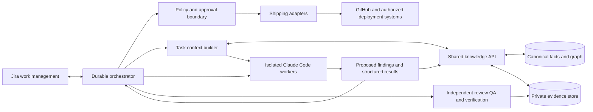

# Architecture

## Control and execution

Claude Code performs engineering reasoning and code changes. An external durable orchestrator owns canonical workflow state, retries, scheduling, dependencies, approval waits, and audit history. Temporal is implemented for the bounded pilot in ADR-010; production hosting and remaining ADR-002 operational gates are open. Worker conversation history is never canonical workflow state.

Start as a modular application with separate worker processes, not a fleet of microservices. The Python package separates contracts, memory, workflow, planning, agents, policy, and certification. Production adapters can replace local adapters without moving policy into prompts.

## Shared knowledge

PostgreSQL persistence for canonical facts, versioned relationships, preview generations and execution audit records is implemented in the [Phase 1 persistence pilot](postgresql.md). A transactional delivery outbox remains a target capability. Evaluate pgvector only against measured retrieval needs. A separate graph database requires an ADR supported by real query/scale evidence.

Memory classes: semantic facts, episodic executions, procedural patterns, scoped working context, and authoritative evidence references. Graph relationships include `CALLS`, `PUBLISHES_TO`, `CONSUMES_FROM`, `DEPLOYED_IN`, `USES`, `IMPLEMENTS`, `CONTAINS`, and `VALIDATES`. Each edge has a service/environment/revision scope, provenance, and observation/expiry times. The local adapter represents facts and edges uniformly as subject/predicate/value records; production ontology validation is future work.

Proposed findings cannot overwrite verified facts. The reference adapter implements Proposed → Verified or Disputed and increments the knowledge version atomically with a change event. Expired evidence is excluded at read time. Corroborated, Superseded, and Stale governance states, explicit supersession, conflict resolution, evidence retrieval/hash verification, and publication of events are future work. An expired conflicting fact still blocks replacement until a governed supersession flow is implemented.

The target API includes `get_service_context`, `get_ticket_context`, `get_dependency_graph`, `search_knowledge`, `get_context_snapshot`, `propose_finding`, `record_decision`, `append_execution_event`, `reconcile_finding`, and `publish_agent_event`. The local adapter implements ticket context, snapshots, graph, proposals and reconciliation plus change-event reads. Phase 1 adds content verification through a local evidence port. The remaining API, authentication and MCP exposure are still planned. Do not treat this list as deployed endpoints.

Context assembly targets scope, freshness, task requirements and access. The local PreviewCoordinator checks the active instance/generation, verifies ticket evidence and caps the snapshot at 200 findings. It compares the full current snapshot again at completion, rejecting stale context. The lower-level `validate_result` only checks request/result bindings; use the coordinator for preview completion. Task-specific ranking, authenticated access and distributed execution fencing remain future work.

## Jira-driven lifecycle

Workstream initiative → service epic → executable engineering tickets → optional subtasks. Jira is the work-management interface; the orchestrator owns execution truth. Webhooks are authenticated, deduplicated, and reconciled against guarded state transitions. A Jira status edit alone cannot authorize shipping.

Every ticket includes source revision, environment, objective, current/desired state, implementation scope, dependencies, acceptance/QA/telemetry/delivery criteria, rollback, and evidence. A deterministic DAG dry-run precedes ticket creation. Creation uses stable plan/ticket idempotency keys and records remote issue IDs.

Engineering path: Planned → Ready → Implementing → In Review → QA Ready → QA Passed → Shipping → Verifying → Accepted. The local reducer guards sequencing, dependencies, actor separation and evidence freshness; it does not execute QA or deploy. Blocked and Canceled are supported, with no implicit resume. A governed remediation/resume flow is deferred.

Target release path: Change Ready → PR Open → CI Passed → Merge Authorized → Merged → Deployment Started → Rollout Healthy → Telemetry Validated → Environment Accepted. Each step needs the exact release identity and its own CI, authorization, deployment or verification evidence. Failures enter Needs Remediation, Awaiting Approval or Rollback Required; retries are bounded and exhausted retries block for human intervention. This release state machine is a design, not implemented in this PR.

Target certification path: Not Assessed → Assessed → Instrumentation In Progress → Certification Ready → Running → Passed / Failed / Incomplete. Ticket-level checks are a subset; final certification accounts for all 120 slots. The report aggregator is implemented; scheduling/query execution is deferred.

## Trust, authorization and recovery

- Repository text, Jira descriptions, retrieved facts, model output, and telemetry are untrusted data. They cannot expand tool permissions or grant approval.
- Workers operate in isolated workspaces with explicit tool/network allowlists, resource limits and short-lived credentials. Never pass production credentials to an engineering worker. Repository hooks/configuration must be reviewed before a non-interactive Claude Code session.
- Only a trusted dispatcher assigns actor identities and roles. Review, QA, and verification are independent of the implementation worker. Strings supplied by the model are not authenticated identity.
- Only the knowledge steward may reconcile canonical state. Agents propose findings. Direct SQLite and PostgreSQL adapters assume trusted callers. The [preview HTTP API](authenticated-api.md) adds operator-provisioned service authentication and exact-scope grants; it is not a complete multi-tenant identity/operations platform.
- Evidence URIs and digests are references. The local EvidenceStore verifies persisted bytes and metadata; a future authenticated evidence service must fetch authorized sources, bind query results to artifacts/windows, and redact content. Local integrity checks prove neither producer identity nor the truth of a remote artifact.
- Non-production promotion defaults to denied until the exact release is explicitly authorized. Production additionally requires an authenticated human approval bound to service, environment, full commit SHA, artifact digest, release-plan digest, gate set, authority and validity window. Revocation or any release change invalidates it.
- Enforce policy again immediately before the external write. Record intent and result with an idempotency key; recover by reconciling remote state after uncertain outcomes. Never claim exactly-once delivery from at-least-once activity execution.
- Limit worker attempts to three and enforce execution timeouts. Remediation has a separately bounded budget. Local request bounds are contracts; an adapter must enforce them.

## Dynamic preview environments

Dynamic non-production previews are an optional execution target for independent QA and telemetry verification. The [preview-environment design](dynamic-environments.md) proposes GitHub-triggered, Helm-based deployments through Argo CD into isolated GKE namespaces, gated by successful builds and exact-release authorization. The orchestrator owns lifecycle and external cleanup; Argo owns Kubernetes convergence. Phase 1 implements instance/generation identity and a local generation registry, while external lifecycle controllers and authorization remain planned. See [ADR-006](adr/006-dynamic-preview-environments.md), [ADR-007](adr/007-instance-scoped-contracts.md) and the [Phase 1 implementation](phase-1-foundation.md).

## Platform observability

Future adapters emit execution/ticket/service IDs, attempt counts, state-transition latency, queue age, token/cost budgets and evidence freshness. Trace the orchestrator-to-worker-to-adapter flow; redact credentials, prompt bodies and raw customer telemetry. Alert on stuck workflows, exhausted retries, approval expiry, knowledge conflicts and telemetry pipeline failures. No telemetry exporter is installed by this PR.

## Implemented execution pilot

Phase 1 increment 4 adds `sre_suite.execution`: real Temporal workflows, restricted Claude Code CLI workers, Jira Cloud intake and idempotent result-property writeback. Shared evidence/context remains behind the existing scoped API; full environment ID/generation checks apply before every gate. A private shared filesystem journal retains immutable model results for retry reuse. See [runtime boundaries and setup](execution-runtime.md) and [ADR-010](adr/010-temporal-execution-pilot.md). Model/Jira tests use fixtures; no shipping or production execution is enabled.

Increment 5 adds optional draft-PR publication after all four gates and configured nonterminal Jira transitions. Every write revalidates scope and evidence; Jira review additionally checks the current PR head. Cross-service partial writes are retained for human reconciliation. See [ADR-011](adr/011-draft-pr-and-jira-transitions.md).
